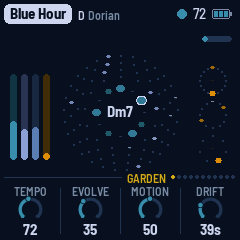
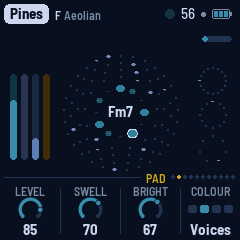
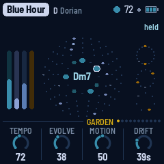

# Nightscape FM for the M-VAVE FM-1

Nightscape FM turns the M-VAVE FM-1 into generative ambient music for night drives, and for the photographs and art
that come back from them. It plays itself from the moment it's switched on: breathing voices, soft bells on tape loops
of unequal length, a gliding bass and quiet Euclidean percussion, all through a tape echo, a long tape loop and a plate
reverb, with chords and keys dealt from a number, whole pieces dreamt from one, new instruments (Strings, Noir, a Lead
synth), and a renderer that plays any piece into a WAV on a computer. Its screen wears the colours of a road at dusk.

It is LowCrabTV's fork of [AMB-1](https://github.com/charlesvestal/fm1-amb) by Charles Vestal, inspired by Brian Eno's
*Music for Airports*, and like AMB-1 it is free software under the Mozilla Public License 2.0.

  

- **The manual**: [docs/MANUAL.md](docs/MANUAL.md)
- **Build it**: run *Build and attest firmware* in this repository's Actions; install its `packages` with
  `python base/tools/fm1_install.py build/release-assets/amb.fwsc`
- **Render it**: `python tools/amb_render.py fetch`, then `render` (manual, section 9)

Installing it is at your own risk, though it's hard to get stuck: AMB-1's
[web installer](https://charlesvestal.github.io/fm1-amb/install/) can put M-VAVE's own firmware back, and an FM-1 that
fails to start twice comes up in a safe mode it can reach.

## In short

| | |
|---|---|
| Keys | The scale: each key adds its note or takes it out |
| PLAY · REC · EDIT | Grow / rest · freeze · the next chord |
| HOME · ENV · ARP · LFO · SEQ · FX · GLO | The pages: Garden, Pad, Bells, Bass, Pulse, Space, Setup; KNOB 1–4 set their values, a layer's level on KNOB 1 |
| SELECT | The previous or next page; with HOME held, the tempo |
| ALGORITHM · PRESETS | The mode · the piece (eight of them) |
| OCT− / OCT+ | The bells' octave |
| SAVE | Saves; held, puts the piece back to its recipe |

Hold any button for a second and a card says what it does.

Nightscape FM also tells the [FM-1 Screen Reader](https://charlesvestal.github.io/fm1-reader/) what its screen
shows, over USB: the page and its knobs, a knob's value as it turns, the piece, the chord as it moves,
and what each button did.

The [manual](docs/MANUAL.md) has the rest.

## Building and testing

Nightscape FM, as AMB-1, is an app on [fm1-base](https://github.com/charlesvestal/fm1-base) (`base/`, a git submodule); clone with
`--recursive`. The toolchain and prerequisites are in [BUILDING.md](BUILDING.md):

```
sh tests/run_tests.sh                                  # the instrument, the app in a simulator, the web builds
./build.sh                                             # app/build/amb.fwsc
python3 base/tools/fm1_install.py app/build/amb.fwsc   # install it over USB
```

`app/build/host/amb_host SCRIPT OUTDIR` runs the whole app on a computer from a script
(`tests/scenarios/*.amb`), with audio and screenshots coming out. `./build.sh --web` builds the same code for the
browser (the emulator); `web/app/build.sh` builds the engine alone into a web app for phone and desktop.

## Credits

The idea comes from Brian Eno's generative music: *Music for Airports*' tape loops of unequal
length, and the echo chain of *Discreet Music*. The reverb is Jon Dattorro's plate ("Effect Design,
Part 1", JAES 1997), as in [FoMni-1](https://github.com/charlesvestal/fm1-fomni); the Euclidean
rhythms are Godfried Toussaint's reading of Bjorklund's algorithm. Nightscape FM is built on
[fm1-base](https://github.com/charlesvestal/fm1-base) and [felucca-bsp](https://github.com/hugelton/felucca-bsp),
from [Felucca](https://github.com/hugelton/Felucca) by Leo Kuroshita (Hügelton Instruments). The idea of running
FM-1 firmware in the browser comes from [Groove OS](https://www.groove-os.com/). MPL-2.0 (0.9 and earlier:
GPL-3.0-only); see [LICENSING.md](LICENSING.md).

M-VAVE and FM-1 are trademarks of their owners. Nightscape FM is not affiliated with M-VAVE, Brian Eno or
Hügelton Instruments.
