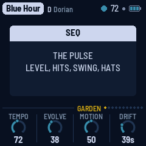
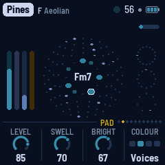
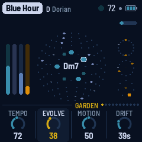
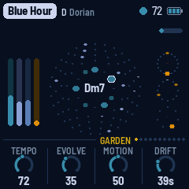
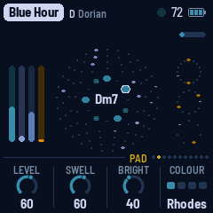
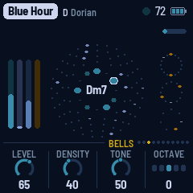
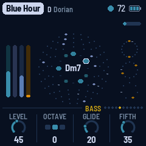
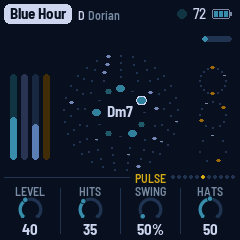
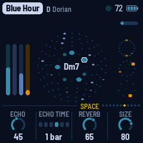
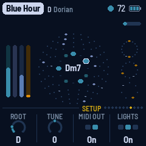

# AMB-1

AMB-1 turns the M-VAVE FM-1 into a generative ambient machine, inspired by Brian Eno's
*Music for Airports*. It plays itself from the moment it's switched on: breathing voices, soft
bells on tape loops of unequal length, a gliding bass and quiet Euclidean percussion, all through
a short echo, a long tape loop and a plate reverb. You don't perform it, you tend it: pick a piece
and a scale, take notes out, put them back, and let it grow.

, running AMB-1, each control labelled")

---

## Contents

1. Install
2. Getting started
3. Controls
4. The screen
5. The garden
6. The pieces
7. The pages
8. MIDI
9. Saving
10. Troubleshooting
11. Parameters
12. Credits

---

## 1. Install

**Try it first:** the [AMB-1 emulator](https://charlesvestal.github.io/fm1-amb/emu/) runs the same
code in the browser, with sound, played with the mouse, a touch screen or the keyboard.

**Install:** open the [web installer](https://charlesvestal.github.io/fm1-amb/install/) in Chrome or
Edge, connect the FM-1 with a USB data cable and press Install. Don't unplug it while it's
writing; when it finishes, the FM-1 restarts into AMB-1.

**Go back:** "Back to the stock firmware", at the bottom of the same page, puts M-VAVE's firmware
back (download the FM-1 V15 file from the link there, choose it, press the button). M-VAVE's own
updater, M-UPGRADE, works too.

> Installing other firmware is at your own risk. If the FM-1 ever won't start, see
> [Recovering an FM-1 that won't start](#recovering-an-fm-1-that-won-t-start).

<details><summary>Install from the command line</summary>

Download the firmware file (for example `amb-1.0.fwsc`) from the
[releases page](https://github.com/charlesvestal/fm1-amb/releases), get the AMB-1 source from GitHub
(`git clone --recursive https://github.com/charlesvestal/fm1-amb`), install Python 3 with
`pip3 install mido python-rtmidi`, and run:

```
python3 base/tools/fm1_install.py amb-1.0.fwsc
```

</details>

---

## 2. Getting started

AMB-1 starts playing as soon as it's on. A few minutes with it:

1. **Listen.** The first piece, Garden, is playing: D Dorian, pad, bells, bass and a soft pulse.
   Turn MASTER for the volume.
2. **Try another piece.** Turn PRESETS. Each of the eight pieces has its own key, tempo, sounds
   and amount of movement.
3. **Change the scale.** Press a key whose note is lit: it leaves the scale, and nothing plays
   it any more. Press it again to bring it back. Any key that isn't lit adds its note.
4. **Move on.** Press EDIT: the pad moves to the next chord at the start of the next bar.
5. **Freeze.** Press REC: the chord holds and the reverb rings on forever, while the bells and
   pulse go on above it. Press REC again to let it go.
6. **Shape a layer.** Each layer has a button: ENV the pad, ARP the bells, LFO the bass, SEQ the
   pulse, FX the space, HOME the garden as a whole, GLO the setup. KNOB 1–4 set the four values
   at the bottom of the screen, a layer's level always on KNOB 1. SELECT steps through the pages.
7. **Rest.** Press PLAY: the garden stops growing and its sounds fade out slowly. PLAY again and
   it grows back.

What you change is kept with the piece. AMB-1 saves it by itself while resting, or press SAVE.

Not sure what a button does? Hold it for a second: a card says. Let go and nothing happens.

---

## 3. Controls

The drawing at the top shows them all; here they are in more detail.

| Control | What it does |
|---|---|
| Keys | The scale. Each key adds its note to the scale or takes it out; the keys light up for the notes in it. Every octave of a note is the same key. The root stays, and the scale keeps at least three notes. |
| PLAY | Grow / rest. AMB-1 starts growing by itself when it's switched on. At rest, the sounds fade out slowly and the reverb rings away. Lit green while growing. |
| REC | **Freeze**: the chord holds and the reverb rings on forever, while the bells and pulse go on dry above it. Press again to thaw. Lit while frozen. |
| EDIT | The next chord, at the start of the next bar (at once while resting). |
| HOME | The Garden page: the whole garden. |
| ENV · ARP · LFO · SEQ | The layers' pages: Pad, Bells, Bass, Pulse. |
| FX · GLO | The Space and Setup pages. The lit button shows the page. |
| SELECT | The previous or next page. Hold HOME and turn it for the tempo, from any page. |
| ALGORITHM | Mode: Ionian, Dorian, Phrygian, Lydian, Mixolydian, Aeolian, pentatonic major and minor. Loads the mode's scale; editing it with the keys makes it Custom. |
| PRESETS | The piece (see [The pieces](#s6)). |
| KNOB 1–4 | The four values on the screen. A few clicks are always single steps; a quick turn speeds up, so half a turn sweeps the range. |
| OCT− / OCT+ | The bells' octave, two down to two up, from any page. |
| MASTER | Volume. |
| SAVE | Saves all eight pieces. Held for 1.5 s: puts the piece back to its recipe. |

**Help:** hold any button but PLAY for a second and a card says what it does. A key, a knob or
another button puts the card away; letting go after it does nothing else.



---

## 4. The screen

")


- **Top line:** the piece, its root and mode. On the right, a slow beat light (a play triangle while
  resting), the tempo (EXT when it follows MIDI clock), a dot when there are unsaved changes, and the
  battery. Messages ("ADDED F#", "NEXT CHORD") show here for a moment.
- **The battery:** three bars when it's full, fewer as it runs down. At one bar or none it turns
  red: time to charge. Plugged into a computer, it shows a lightning bolt instead. While it charges
  from a wall charger, the bars read high.
- **Top right of the garden:** a thin bar fills up on the way to the next chord; while frozen it
  says "held".
- **The ring:** the twelve notes, C at the top. Notes in the scale are green, the chord's notes
  a deeper green, the root is ringed in ink. The chord's name is in the middle.
- **Around it:** the four bell loops, 13, 17, 23 and 29 beats, from the inside out. Each dot is a
  beat; the blue ones hold a note. A playhead goes round each loop and glows when it rings a bell.
- **Left:** the four layers' levels as they sound: pad (green), bells (blue), bass (olive),
  pulse (dark).
- **Right:** the three pulse rings: thump (16 steps), closed hat (12) and open hat (7). Hits
  fade while the pulse sits a few bars out.
- **Bottom:** the page's name and seven dots, one a page, then its four values, one for each knob:
  a dial (or, for a switch, its positions) and the value. The one you're turning lights up.



---

## 5. The garden

AMB-1 grows four layers from one scale and one chord.

- **Pad:** four breathing voices. Each swells in, hangs and fades on its own cycle (unequal
  lengths, around 11 to 19 seconds at first, as in the tape loops of "2/1"), taking its note of
  the chord as it starts, so the chord forms and dissolves instead of sitting there. Two colours:
  a filtered Rhodes that blooms brighter as it swells, or sung voices. Every so often (**Drift**)
  the chord moves to another one in the scale. Voices on notes the new chord shares hold to the
  end of their breath; the others fade out and breathe in again on their new notes.
- **Bells:** FM bells, soft-struck like a piano slowed to half speed, played by four tape loops
  13, 17, 23 and 29 beats long. Each loop holds a few notes, so the loops slide against each other
  and the melody never quite repeats. Each loop is its own shade of bell, and now and then a
  note rings with its octave.
- **Bass:** the chord's root, low and soft, gliding; sometimes it leans on the fifth.
- **Pulse:** a soft thump tuned to the chord's root, a closed hi-hat and an open one, each on its
  own Euclidean pattern over 16, 12 and 7 sixteenths: polyrhythms. The patterns slowly turn and
  gain or lose a hit.

Then the space, after Eno's chain for *Discreet Music*: a short tape echo, a long tape loop (up to
5.6 seconds, with two heads, each repeat coming back darker and thinner) and a plate reverb.
They're most of what you hear. The echo is stereo, and it evolves: with **Motion** up, its two
heads wander across the field, the repeats fall in changing patterns, and now and then the second
head slides to another part of the loop, bending the repeats a little as it goes.

Over it all:

- **The arc:** a slow tide, a few minutes from end to end, between sparse (fewer bells, a darker
  pad, a quieter pulse, more reverb) and full. **Motion** sets how far it swings, and how far the
  smaller things wander: pitch, pan, the vowel, the echo's heads.
- **Rests:** with **Evolve** up, the layers take breaths: the pulse sits out two to four bars,
  the held bass skips a chord, a bell loop goes quiet for a pass.

---

## 6. The pieces

PRESETS chooses one of eight pieces. Each is a recipe for the whole garden: the layers, the
sounds, tempo, key and mode, how busy it is and how far it moves. Each remembers how you left it.
Hold SAVE for 1.5 s to put the piece you're on back to its recipe. Tune, MIDI out and Lights are
the same for all.

| Piece | What it is |
|---|---|
| **Garden** | D Dorian, 72: everything, gently. Rhodes. |
| **Departures** | C# Ionian, 60: soft, slowed-piano bells an octave down over a quiet Rhodes, as "1/1". |
| **Voices** | F Aeolian, 56: only the sung voices on unequal loops and a low bass, as "2/1". |
| **Afternoon** | G Lydian, 84: a bright Rhodes, busier bells, a light pulse. |
| **Night Bus** | A Aeolian, 96: the pulse forward, metallic bells, short echoes. |
| **Shoreline** | E pentatonic major, 64: dark, round bells lost in long echoes, as "2/2". |
| **Glass** | Eb pentatonic minor, 76: clangy bells an octave up, dense. |
| **Tides** | Bb Mixolydian, 70: sung voices, the most changeable (Evolve and Motion high). |

---

## 7. The pages

**Hold SELECT** on the Garden, Pad, Bells, Bass, Space, Chords or Roots page and the knobs change to that page's other
settings; let go and they're back. Holding and turning doesn't change the page.

One page a layer, each on its own button, with four values on KNOB 1–4. A layer's level is
always KNOB 1. SELECT steps through them in this order.

### HOME: Garden



- **Tempo:** 30 to 120 (also HOME + SELECT, from any page).
- **Evolve:** how restless the garden is. At 0 the loops repeat exactly. Turned up, a bell note
  now and then changes or moves at the end of a pass, the pulse patterns turn and gain or lose a
  hit, and the layers take rests.
- **Motion:** how far the arc swings, and how much pitch, pan, the vowel and the echo wander
  (at 0 the echo stays put: one head left, one right).
- **Drift:** how long a chord lasts before the pad moves on, 20 seconds to 5 minutes (each time a
  little more or less). EDIT moves on now.

### SELECT: Chords

The slate: up to four chords in order, each for a set number of bars, in place of Drift. Press
SELECT for the page.

- **KNOB 1–4:** each step's chord, named as you turn (`Dm7`), from the chords of the scale. Each
  root comes in six shapes, in this order: seventh (`Dm7`), triad (`Dm`), `sus2`, `sus4`, `add9` and
  sixth (`Dm6`). All of them keep to the scale, so nothing can clash; the bells, the arp and the bass
  follow the shape. A pentatonic scale has fewer, and the knob skips the repeats. **Off** skips that
  step. With all four off, the chord drifts as usual, and KNOB 1 reads **Drift**.
- **Hold SELECT and turn KNOB 1–4:** that step's length: 1, 2, 3, 4, 6, 8, 12 or 16 bars. Short
  chords may not let the pad finish breathing in: at most tempos, try 4 bars or more.
- **EDIT** goes to the next step on the next bar, and **REC** holds the step. Each piece keeps its
  own slate.

### SELECT again: Roots

The root rotator: up to four root notes in order, each for a set number of bars, like the slate
but for the key. Press SELECT from the Chords page, and again to go back. The scale moves with the
root, and so do your chords: Dm7 and G7 in D become Gm7 and C7 in G.

- **KNOB 1–4:** each step's root. Turned up from **Off**, a knob starts on the piece's own root and goes on
  up round the notes. **Off** skips that step. With all four off, the Root on the Setup page is in charge,
  and KNOB 1 reads it (**Root D**). While any step is on, the rotator is, and the Setup page's Root reads
  **Roots**; it can't be turned until the steps are off.
- **Hold SELECT and turn KNOB 1–4:** that step's length: 1, 2, 4, 8, 12, 16, 24 or 32 bars.
- **Each new root starts the chords again from their first step**, so sections line up like a verse
  and a chorus. Make a root last as long as your chords add up to, or the last ones won't be reached.
  With no chords set, each new root begins on the home chord. A step on the same root as the one before
  starts nothing again, so a single root simply holds and the chords go on.
- The change lands on a bar line; the pad's voices fade in about a second and come back on the new
  root. **REC** holds it. Each piece keeps its own.

### SELECT a third time: Deal

The dealers: a number writes the Chords page's four steps, or (SELECT held) the Roots page's, the same each time
for that number. What they deal is yours to turn like anything you set; a toast names it (**DEALT** Dm7 Em7 F
G7, **KEYS** D G C). Press SELECT from the Roots page, and again to go back to Chords.

- **Deal (KNOB 1):** **Off**, or 1 to 999. Off leaves the steps as they are, dealt or your own.
- **Chords (KNOB 2):** 2, 3 or 4.
- **Spice (KNOB 3):** how far it roams. Low keeps to the old order: home, then a chord that leads away, then one
  that leads back (I IV V, I vi IV V, ii V, and each scale's own: i VII VI, I bVII IV), as plain sevenths and
  triads. On up come the softer and the surprising turns, the sus, add9 and sixth colours, and at the top the
  weaker, dreamier moves. Always in the scale.
- **Form (KNOB 4):** how long each chord lasts, the whole always 8, 16 or 32 bars, as phrases go. **Even**:
  equal (three chords: the last held). **Home**: the first longest. **Turn**: the last short, turning back.
- **Guardrails, at every Spice:** the first chord is home; no chord twice; the last leads home well; the
  diminished chord only with Spice, and never the longest.

**Hold SELECT: the keys.** The same four knobs for the Roots page: **Key deal**, **Keys** (2 to 4), **Spice**
and **Form**. Keys feel near or far by the notes they share: a fourth or fifth shares six of seven, a whole
step five, a minor third four, a major third three, a half step or the tritone two. Low Spice keeps to fifths
and whole steps; on up, minor thirds, then major, then the far ones. The journey starts at the piece's root
and comes home; two far moves never run together (below the top); and each key lasts whole passes of the
chords, so a progression is never cut off. Form: **Even** (one pass each), **Slow** (two), **Home** (home
two), **Lift** (home long, then the last key a whole step above the one before: the last chorus's lift).
Turning the chord dealer deals the keys again too, to fit the new length.

### Hold SELECT: Dream, on the Setup page

One number deals the whole piece: the garden's Seed, both dealers on the Deal page, and, with Range, the piece's
sound. Everything it deals shows on its own page and can be turned by hand after.

- **Dream (KNOB 1):** **Off** leaves the piece as you set it. **Wild** deals a new dream at each PLAY and each
  time you come to the piece. A number, 1 to 999, deals the same dream each time. Turned up from Wild, the knob
  keeps the dream playing; on from there, its neighbours. A toast names it (**DREAM 417**, and its chords).
- **Range (KNOB 2):** how far the sound may move from the piece's recipe. At 0 only the notes, the chords and
  the keys are dealt. On up, the levels, Density, Evolve, Motion, Hits, Hats, Swing, the echo and reverb, the
  pad's Swell and Bright, the bells' tone, Glide, Fifth, Sparkle and Swoosh move too, each within a window round
  the recipe, so the piece stays itself. The tempo moves at most 15%. The instruments and voicings come
  too, more often the higher it is: the pad's Colour (Rhodes, Voices, Strings, Noir), the bells' Colour
  (Lead less often, and with it Density no higher than 45, so the solo sings), the pad's Notes (from 30)
  and the bells' octave, one either way.
- **Spice cap (KNOB 3):** the most Spice either dealer may be given.
- **What it never does:** turn on a part the recipe has off, or turn one down to nothing; change the scale, the
  piece's root, the tuning or MIDI.
- **Your hand comes first.** Turn any knob, an instrument, a voicing, a level, at any time: it stays as you
  set it until Dream deals again, at the next turn of Dream, Range or Spice cap, or, in Wild, the next PLAY.
  To keep a version you've changed, turn up to its number first, then save.

### Hold SELECT: Sparkle, on the Garden page

Little flourishes on the bells, coming and going in waves: a run of the scale, a grace note, the
pad's note up high, and a rising chord when one comes. All of the chord and its scale.

- **Sparkle (KNOB 1):** how much at the peak of a wave. 0 is off.
- **Length (KNOB 2):** how long each wave swells and wanes, 5 s to 1 minute.
- **Often (KNOB 3):** the rest between waves, 10 s to 5 minutes.

Each wave varies a little, and the arc leans on it. It shares the bells' voices, and its volume
follows the Bells level. Turned up from 0, the first wave starts within a couple of seconds.

### Hold SELECT: Pad, Bass and Bells

- **Pad, Notes (KNOB 2):** how much of the chord the pad sings. 4 is the whole chord; 3 its root,
  third and fifth; 2 its root and fifth, open. Under 4, the arc moves it by one as each chord comes.
- **Bass, Notes (KNOB 2):** **Held** is the one long note. Turned up, the bass keeps a steady speed:
  1 note a bar (1 to 24), 2 (25 to 49), 4 (50 to 74) or 8 (75 to 100). The arc and Evolve never change
  that speed. It plays the root first, then the fifth (from 25), the octave (from 50), and the third
  and seventh (from 75). Only the chord's tones, so it follows the slate and the drift. Fifth is for
  the held bass; with Notes up, Glide is capped so each note arrives.
- **Bells, Colour (KNOB 1):** the bells' sound. **Bell** is the one they've always had; **Soft** is round,
  with no strike; **Wood** is hollow and holds; **Strings** swell slowly and hang; **Piano** strikes
  warm and mellows. Tone still shapes each one. The loops, the arp and Sparkle all play through it.
  They are the same two operators set differently: impressions, not the instruments themselves.
  **Lead** is not a bell: a solo synth that takes all their notes, two voices in turn, so each starts clean on its
  pitch while the one before trails off:
  two saws through a filter that opens as it sounds, a late vibrato, into the echo and reverb.
  Bell tone is its brightness. With busy loops it runs; with few, it sings.

### ARP again: Arp

Press ARP from the Bells page for the arp's own page, and again to go back.

- **Arp (KNOB 1):** **Off**, or an arpeggio of the chord's tones in place of the loops: **Up**,
  **Down**, **Up/Dn**, **Dn/Up**, **Random**, **Converge** (in from both ends) or **Diverge** (out
  from the middle). The loops keep turning, silent, for when it's off.
- **Rate (KNOB 2):** 1/4, 1/8., 1/8 or 1/16. Faster, the bells ring shorter.
- **Range (KNOB 3):** 1 to 3 octaves, from the chord's root. Octave moves it up and down.
- **Poly (KNOB 4):** **Off**, or the arp against the grid: **3:4**, **5:4**, **3:2** or **7:4**
  (so many notes in the time of so many Rate steps). It stays locked to the tempo, shifts against
  the pulse and comes back around. Every note takes the chord as it's struck.
- **With the arp on, Density** (on the Bells page) picks which of 16 steps sound, spread as Hits does
  the pulse: 100 plays every step. The arc and Evolve act on it, and Swing does while Poly is off.

### ENV: Pad



- **Level.**
- **Swell:** how long the voices breathe, from a few seconds to about half a minute.
- **Bright:** opens the pad's filter and brightens the Rhodes; for the Voices it also moves the
  vowel from "oo" to "eh".
- **Colour:** **Rhodes**; **Voices**; **Strings**, a section's bow, two saws a little apart through a
  warm filter that Bright opens; or **Noir**, brass in the manner of a CS-80, a filter that blooms
  open with each breath and a slow vibrato, for the rain-and-neon feel. Each piece keeps its own.

### ARP: Bells



- **Level.**
- **Density:** how many notes each loop holds, none at 0 to five at the top. Low, they're the
  chord's tones; from 20, passing notes come in. A change shows up as
  each loop comes round.
- **Tone:** from round and soft-struck to a long metallic clang.
- **Octave:** two down to two up (OCT− and OCT+ too).

### LFO: Bass



- **Level.**
- **Octave:** one down, home, or one up.
- **Glide:** how slowly the bass slides to its next note, from a quick step to over a second.
- **Fifth:** how often, halfway through a chord, the bass leans on the fifth.

### SEQ: Pulse



- **Level.**
- **Hits:** how many beats the three rings play, the pattern's home. 0: no thump, and no hats until Hats goes
  past 50.
- **Swing:** the off sixteenths later, from straight (50%) to a heavy lilt (75%).
- **Hats:** how much hat, all at once: how many, how loud and how bright. **0** is none, and the thump plays
  on. Up to **50** they come in, few, soft and dark. **50** is what Hits gives them. On up to **100** they
  fill the ring, brighter and longer, with ghost notes between the hits and, near the top, quick rolls.

### FX: Space



- **Echo:** how much goes to the echoes.
- **Echo time:** the tape loop's length: a dotted quarter, a half, a dotted half, 1, 2 or 4 bars,
  shortened to fit its 5.6 seconds at slow tempos. The second head repeats at three quarters of it,
  or with Motion up, at two thirds, five eighths, a half or three eighths.
- **Reverb:** how much goes to the plate.
- **Size:** how long the plate rings, from a room to a long hall, and how many times the echo
  comes back.

### Hold SELECT: Seed, on the Garden page

**KNOB 4**, beside Sparkle's three. A piece's knobs are its personality; the dice decide the rest: which notes
the bells' loops hold, how the patterns turn, where the chords drift, how the arc rises and falls.

- **Wild** (all the way down) is a new garden each time, as it always was.
- **A number, 1 to 999,** grows the same garden each time you press PLAY. It still grows and changes as
  Evolve says, the same way each time, so long as you leave the knobs alone; turn one, and it goes its own way
  from there.
- **Turned up from Wild,** the knob lands on the number of the garden growing now, and keeps it. Nothing starts
  again; the next PLAY grows it from its beginning, the loops it began with. Turn on from there to try others.
- SAVE keeps it with the piece. The pad's breathing, the echo's drift and Swoosh's passes stay free.

### Hold SELECT: Swoosh, on the Space page

Falling stars of noise. Each pass swells and wanes on a gentle curve, falling from bright to dark as
it crosses from one side to the other, into the echo and the reverb. It has no pitch, so it sits with
any chord or root. The garden plays the same notes with it or without.

- **Swoosh (KNOB 1):** how loud. 0 is off; 1 is barely there; 100 is as loud as the piece.
- **Length (KNOB 2):** how long each pass lasts, 2 to 20 s.
- **Often (KNOB 3):** the rest between passes, 10 s to 5 minutes.
- **Tone (KNOB 4):** white noise at 0, airy and bright; brown noise at 100, dark and rumbling.

Each pass varies a little in length, height and direction. Echo and Reverb set how much of a trail it
leaves. Turned up from 0, the first pass starts within a couple of seconds.

### GLO: Setup



- **Root:** the key's root note. The scale moves with it.
- **Tune:** fine tuning, ±50 cents.
- **MIDI out:** on or off.
- **Lights:** On: the keys light the scale, and the unlit buttons glow dimly so they can be read
  on the black FM-1. Keys: the key lights only. Off.

The top right of this page shows how much of the FM-1's time the sound takes (CPU).

---

## 8. MIDI

MIDI comes in over USB and the TRS jack, and goes out over USB.

- **In, channel 1:** a note adds or removes its note from the scale, like a key.
- **In, clock:** the beat follows MIDI clock, and start / stop start and stop the garden. The
  screen shows EXT for the tempo.
- **Out** (on by default): the pad on channel 1, the bells on 2, the bass on 3 and the pulse on 10,
  and clock with start / stop when AMB-1 runs on its own tempo. Turning MIDI out off sends all
  notes off.

### Screen reader

AMB-1 can tell a screen reader what its screen shows. Connect the FM-1 by USB, open the
[FM-1 Screen Reader](https://charlesvestal.github.io/fm1-reader/) in Chrome or Edge, and click
Connect. It reads out the page you're on and its knobs, a knob's value as you turn it, the piece
and its key, the notes you add or take out, help cards, every message, and the chord each time
the garden moves on, in words: "E flat pentatonic minor", not "Eb Pent min".

The page can speak with its own voice or pass everything to your own screen reader (VoiceOver,
NVDA, JAWS, TalkBack). Press W to hear the whole screen again: the page, the piece, the battery, the
chord and the scale. The FM-1 says nothing until the page connects, so a DAW on the same cable never sees it.

---

## 9. Saving

AMB-1 keeps all eight pieces in the FM-1's memory, each as you left it: the knobs, the scale,
the tempo, the pad's colour and the bells' octave, plus Tune, MIDI out and Lights.

- **By itself:** a few seconds after a change, but only while resting. Writing to the memory
  interrupts the sound for a moment, so it never happens while the garden grows. A dot at the top
  of the screen means there are unsaved changes.
- **SAVE:** saves now, playing or not.
- **Hold SAVE** for 1.5 s: the piece goes back to its recipe. That isn't saved until the next save,
  so switching off before then brings your version back.

---

## 10. Troubleshooting

**Update mode:** hold OCT- and OCT+ together for five seconds. A countdown appears; let go
before it ends to cancel.

**Calibration:** if a button or knob does the wrong thing, hold OCT- and OCT+ while you switch
the FM-1 on. The screen then asks you to press each button and turn each knob in turn.

**After a crash:** AMB-1 shows a red CRASH screen and restarts by itself a few seconds later. The
next start shows RESTARTED AFTER A CRASH and an address (PC ...) for a moment. If you report the
problem, include that address and what you were doing.

**Safe mode:** if AMB-1 crashes twice in a row while starting, it starts in SAFE MODE instead.
There's no sound, but USB works, so the web installer can reach it: reinstall AMB-1, or put the
stock firmware back from the same page. Press PLAY to try starting AMB-1 normally again. If even
safe mode fails twice, the FM-1 drops into the chip's own update mode, and only the rescue below
can reach it.

### Recovering an FM-1 that won't start

An FM-1 in the chip's own update mode shows a blank screen, and neither the web installer nor
M-VAVE's updater can see it. A script can put M-VAVE's firmware back, on a Mac, with the USB cable
you already have.

Open Terminal, paste this line and press Return:

```
bash -c "$(curl -fsSL https://raw.githubusercontent.com/hugelton/felucca-bsp/main/tools/fm1_rescue.sh)"
```

1. If a window asks to install the command line developer tools, click Install. When it has
   finished, paste the line again.
2. If it asks for a password, type your Mac password (nothing shows as you type) and press Return.
3. When it says it's waiting, plug the FM-1 in and switch it on. The script catches it, checks the
   chip, saves a backup of the FM-1's memory in the `fm1-rescue` folder in your home folder, and
   asks before it writes anything.
4. Type **yes** and press Return. Don't unplug anything until it says it's restarting the FM-1.
   The FM-1 then starts into its original firmware, and you can install AMB-1 again from there.

The script downloads M-VAVE's FM-1 V15 firmware and JieLi's flash loader, and checks both against
known fingerprints. It writes only the firmware area of the memory, never the bootloader or the
FM-1's own settings, and checks everything it writes. Running it again is always safe. If it fails,
copy everything in the Terminal window and
[open an issue](https://github.com/charlesvestal/fm1-amb/issues). If the FM-1 never shows up at
all, Felucca's [FM-1-transporter](https://github.com/kurogedelic/FM-1-transporter) (a small
RP2040 board wired to the USB lines) can still reach it.

---

## 11. Parameters

The defaults are Garden's; each piece has its own.

| Page | Value | Range | Garden |
|---|---|---|---|
| Garden | Tempo | 30–120 | 72 |
| Garden | Evolve | 0–100 | 35 |
| Garden | Motion | 0–100 | 50 |
| Garden | Drift | 20 s – 5:00 | 25 (about 40 s) |
| Chords | Chord 1–4 | Off, or a chord of the scale in one of six shapes | Off |
| Chords | Bars 1–4 (SELECT held) | 1, 2, 3, 4, 6, 8, 12, 16 | 4 |
| Roots | Root 1–4 | Off, C – B | Off |
| Roots | Bars 1–4 (SELECT held) | 1, 2, 4, 8, 12, 16, 24, 32 | 8 |
| Garden | Sparkle (SELECT held) | 0–100 | 0 |
| Garden | Length (SELECT held) | 5 s – 1 min | 20 s |
| Garden | Often (SELECT held) | 10 s – 5 min | 45 s |
| Pad | Notes (SELECT held) | 2, 3, 4 | 4 |
| Bells | Colour (SELECT held) | Bell, Soft, Wood, Strings, Piano, Lead | Bell |
| Arp | Arp | Off, Up, Down, Up/Dn, Dn/Up, Random, Converge, Diverge | Off |
| Arp | Rate | 1/4, 1/8., 1/8, 1/16 | 1/8 |
| Arp | Range | 1–3 octaves | 2 |
| Arp | Poly | Off, 3:4, 5:4, 3:2, 7:4 | Off |
| Bass | Notes (SELECT held) | Held, 1–100 (1, 2, 4 or 8 notes a bar) | Held |
| Pad | Level | 0–100 | 60 |
| Pad | Swell | 0–100 | 60 |
| Pad | Bright | 0–100 | 40 |
| Pad | Colour | Rhodes, Voices, Strings, Noir | Rhodes |
| Bells | Level | 0–100 | 65 |
| Bells | Density | 0–100 (0 to 5 notes a loop) | 40 |
| Bells | Tone | 0–100 | 50 |
| Bells | Octave | −2 – +2 | 0 |
| Bass | Level | 0–100 | 45 |
| Bass | Octave | −1 – +1 | 0 |
| Bass | Glide | 0–100 (20 ms – 1.2 s) | 20 |
| Bass | Fifth | 0–100 | 35 |
| Pulse | Level | 0–100 | 40 |
| Pulse | Hits | 0–100 | 35 |
| Pulse | Swing | 50%–75% | 50% |
| Pulse | Hats | 0–100 | 50 |
| Space | Echo | 0–100 | 45 |
| Space | Echo time | 1/4., 1/2, 1/2., 1 bar, 2 bars, 4 bars | 1 bar |
| Space | Reverb | 0–100 | 65 |
| Space | Size | 0–100 | 80 |
| Space | Swoosh (SELECT held) | 0–100 | 0 |
| Space | Length (SELECT held) | 2–20 s | 6 s |
| Space | Often (SELECT held) | 10 s – 5 min | 28 s |
| Space | Tone (SELECT held) | 0–100 (white to brown) | 50 |
| Garden | Seed (SELECT held) | Wild, 1–999 | Wild |
| Deal | Deal, Chords, Spice, Form | Off, 1–999; 2–4; 0–100; Even, Home, Turn over 8, 16, 32 bars | Off, 4, 30, Even 16 |
| Deal | Key deal, Keys, Spice, Form (SELECT held) | Off, 1–999; 2–4; 0–100; Even, Slow, Home, Lift | Off, 3, 30, Even |
| Setup | Dream, Range, Spice cap (SELECT held) | Off, Wild, 1–999; 0–100; 0–100 | Off, 30, 70 |
| Setup | Root | C – B | D |
| Setup | Tune | −50 – +50 cents | 0 |
| Setup | MIDI out | Off, On | On |
| Setup | Lights | Off, On, Keys | On |
| ALGORITHM | Mode | 8 modes, or Custom | Dorian |

---

## 12. Credits

AMB-1 is free software under the GNU General Public License, version 3. If you share the
firmware, you must also share its source code.

- The idea comes from Brian Eno's generative music: *Music for Airports*' tape loops of unequal
  length, and the echo and tape-delay chain of *Discreet Music*.
- The reverb is Jon Dattorro's plate ("Effect Design, Part 1", JAES 1997), by way of
  [FoMni-1](https://charlesvestal.github.io/fm1-fomni/).
- The Euclidean rhythms are Godfried Toussaint's reading of Bjorklund's algorithm.
- The platform (hardware layer, USB, update loader, installer and storage) is
  [fm1-base](https://github.com/charlesvestal/fm1-base) and [felucca-bsp](https://github.com/hugelton/felucca-bsp),
  from **Felucca** by Leo Kuroshita, Hügelton Instruments.
- The idea of running FM-1 firmware in the browser comes from [Groove OS](https://www.groove-os.com/).
- The fonts are Barlow Semi Condensed and Terminus (SIL Open Font License).

M-VAVE and FM-1 are trademarks of their owners. AMB-1 is not connected with M-VAVE, Brian Eno or
Hügelton Instruments.
